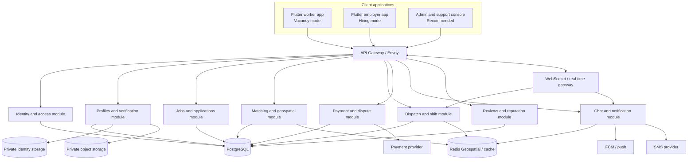

# Architecture README

## 1. Architecture goals

Kalla-Lai is a real-time, location-aware labor marketplace. The architecture must support two-sided user journeys, sensitive identity data, near-real-time dispatch, shift coordination, and auditable payment state changes.

Primary quality goals:

- Clear separation between presentation, business rules, and infrastructure.
- Server-authoritative decisions for verification, matching eligibility, shift state, and money.
- Reliable geospatial queries and real-time updates.
- Isolation of identity documents and other sensitive information.
- Observable, recoverable services with controlled access and tested backups.
- Scalable service boundaries without introducing unnecessary operational complexity too early.

## 2. Logical system diagram



This is a logical view, not a final deployment topology. The admin console and separate private identity vault are implementation recommendations derived from the role and data-sensitivity requirements.

## 3. Client architecture

**Specified:** Flutter/Dart for a shared iOS and Android application; Bloc/Cubit state management; Clean Architecture with Data, Domain, and Presentation layers; Google Maps SDK for Flutter with Mapbox GL as a possible fallback.

Suggested feature organization:

```text
lib/
  core/
    config/       # environment-safe client configuration
    networking/   # API client, interceptors, error mapping
    routing/      # navigation and access guards
    theme/        # tokens, typography, reusable styles
    widgets/      # shared UI components
  features/
    auth/
    onboarding/
    verification/
    worker_profile/
    vacancy_discovery/
    hiring/
    applications/
    shifts/
    chat/
    payments/
    reviews/
    settings_privacy/
```

Each feature should separate:

- **Presentation:** screens, widgets, form state, Bloc/Cubit.
- **Domain:** entities, business rules, use cases, repository interfaces.
- **Data:** API models, DTO mapping, repository implementations, local cache adapters.

Do not put payment, eligibility, verification, or authorization rules only in client code.

## 4. Backend architecture

**Specified:** Node.js and/or Go backend services, Envoy Gateway, REST/GraphQL endpoints, and WebSockets (Socket.IO/gRPC) for chat, positions, and shift synchronization.

**Recommended:** begin with a modular backend if the team and operational capacity are small. Maintain explicit module boundaries and contracts. Extract high-load or independently owned domains into deployable services when evidence supports it. This reconciles the original microservices target with the addendum's warning against premature microservices.

Suggested domain modules:

| Module | Owns |
|---|---|
| Identity & Access | accounts, authentication references, sessions, roles, account recovery |
| Verification | verification cases, status, restricted evidence references, review outcomes |
| Profiles | worker/employer public and private profile fields, skills, portfolio metadata, rates |
| Jobs | requisitions, requirements, budgets, publication and cancellation |
| Matching | skill/proximity filtering, search ranking, availability constraints |
| Dispatch & Shifts | offers, acceptances, schedules, attendance, arrival and completion records |
| Payments | invoice state, provider references, ledger entries, settlement and dispute state |
| Messaging | conversations, messages, push/SMS notification orchestration |
| Reviews | blind review submission, reveal rules, reliability indicators |
| Support & Audit | support cases, administrative actions, audit records |

## 5. Data and infrastructure choices

| Concern | Specified technology or approach | Boundary |
|---|---|---|
| Durable business data | PostgreSQL | System of record for users, jobs, shifts, payments, and state transitions |
| Geospatial queries | PostGIS and geohash/spatial indexing | Query nearby jobs/workers; apply access policy before returning exact location |
| Cache and transient state | Redis Geospatial | Cache worker location, geospatial search aids, short-lived session/ephemeral data; not authoritative for payment state |
| Media | Google Cloud Storage or AWS S3, with CDN | Private object storage; use authorized, expiring access for private files |
| API edge | Envoy Gateway | Routing, policy enforcement, rate limits, TLS configuration, request limits |
| Real time | WebSockets / Socket.IO / gRPC | Authorized position, chat, and shift state updates |
| Notifications | FCM and SMS fallback | Deliver dispatch and shift reminders; messages must not disclose unnecessary sensitive data |
| Payments | Stripe Connect / Adyen named as candidates | Provider feasibility, availability in Nepal, and legal structure must be confirmed |

## 6. Trust boundaries

1. **Client to API:** the client is untrusted. Validate all inputs and authorize every resource access on the server.
2. **API to domain modules:** modules should call explicit interfaces and enforce domain invariants.
3. **Domain to sensitive storage:** identity files and OCR/biometric-related data require isolated permissions and audit trails.
4. **Platform to payment provider:** verify signed webhooks, use idempotency, reconcile provider state, and never rely on client-reported payment success.
5. **Platform to push/SMS provider:** send minimum necessary information; direct users into the authenticated app for sensitive details.

## 7. Key architecture rules

- PostgreSQL is authoritative for all durable business state.
- Redis is rebuildable and may lose ephemeral data without corrupting the business ledger.
- Use transactions for multi-record state changes that must succeed together.
- Use idempotency keys for job acceptance, completion, payment actions, and webhook processing.
- Separate private identity evidence from the worker's ordinary profile and portfolio.
- Store media outside public web roots and serve it through authorization-aware, short-lived access links.
- Keep development, staging, and production environments separate.
- Record security-relevant state changes in an audit trail without copying secrets or full identity payloads into logs.

## 8. Scalability targets from the specification

The source document states a target of geospatial search under **250 ms** for a **25 km** radius with **10,000 concurrent active users**, and **99.95% API uptime** with multi-region Kubernetes and geo-replicated database instances. Treat these as target service-level objectives to verify through load tests and operational design—not proven current performance.

## 9. Decisions before implementation

- Choose Node.js, Go, or a split by measured team capability and workload.
- Decide modular monolith versus service deployment strategy.
- Select a queue/event broker if background jobs require one; the original specification does not name a broker.
- Choose cloud region and data residency approach after legal/provider review.
- Confirm map provider cost, map coverage, geocoding quality, and background location constraints.
- Confirm payment provider availability and the legal structure of any escrow or holding arrangement.
