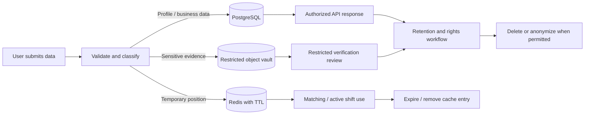

# Data & Memory README

## 1. What “memory” means in this application

In this documentation, **memory** means the application's persisted business data and short-lived runtime state. The supplied product specification does **not** define an AI conversational-memory feature or an LLM agent memory. Do not build or advertise an AI memory system based on this document alone.

Separate the app's state into three categories:

1. **Durable memory / system of record:** PostgreSQL records that must survive app restarts and server restarts.
2. **Ephemeral memory / cache:** Redis entries and in-process state that can expire or be rebuilt.
3. **Device UI state:** temporary Flutter Bloc/Cubit state and carefully selected local preferences. Sensitive records should not be cached casually on the device.

## 2. Storage responsibilities

| Store | Responsibility | Must not become |
|---|---|---|
| PostgreSQL + PostGIS | Accounts, profiles, jobs, applications, shifts, payment references/ledger, reviews, disputes, audit metadata, durable location-related records where justified | A public bucket for raw identity files |
| Redis | Geospatial worker-location cache, transient session data, short-lived coordination state, rate-limit counters | The only record of a payment, verification decision, or job acceptance |
| Private object storage | CVs, video pitches, identity evidence where lawful and necessary | Publicly listable media storage |
| Device state | Screen state, filters, non-sensitive preferences, temporary form drafts where safe | Long-term storage of ID documents, access tokens in insecure storage, or authoritative payment status |

## 3. Suggested conceptual entities

The following is a recommended starting model, not a final database migration. Normalize and refine it after the team confirms the business rules.

| Entity | Example fields / purpose |
|---|---|
| `users` | id, account status, verified contact references, created_at |
| `roles` / `user_roles` | worker, employer, moderator, billing administrator |
| `worker_profiles` | user_id, public name, base area, rate preferences, availability settings |
| `employer_profiles` | user_id or organization_id, display name, trust/review status |
| `skills` / `worker_skills` | skill catalog and worker proficiency/experience links |
| `verification_cases` | user_id, state, provider/case reference, review timestamps, decision metadata |
| `private_document_refs` | opaque object reference, document category, access classification, retention metadata |
| `worker_media` | CV/video metadata and private object references |
| `jobs` | employer_id, role, description, work mode, location, radius, budget, status |
| `job_requirements` | skill, qualification, certification and baseline capability requirements |
| `applications` / `offers` | worker/job references, status, timestamps, offer terms |
| `shifts` | job_id, worker_id, schedule, location policy, current status |
| `attendance_events` | shift_id, event type, timestamp, evidence metadata, minimal location data if needed |
| `invoices` | shift_id, hours, amount, deductions, currency, status |
| `payment_transactions` | provider references, idempotency key, status, amount, timestamps |
| `ledger_entries` | append-only financial movements and reversals; balance derived from entries |
| `disputes` | invoice/shift reference, reason, evidence references, status, resolution |
| `conversations` / `messages` | authorized participants, message content, delivery metadata, retention state |
| `reviews` | author, recipient, score, text, submission and reveal timestamps |
| `audit_events` | actor, action, resource, timestamp, outcome, correlation id; no secrets |

## 4. Data ownership and read boundaries

- A worker may read and update permitted fields in their own profile, but cannot read another worker's private documents.
- An employer may manage their own requisitions and access only applicants/workers authorized for those requisitions.
- Moderators and billing administrators receive separate, least-privilege permission scopes.
- Identity evidence should be served only through a narrowly authorized verification workflow.
- Public profile APIs should return only fields intentionally selected for public display.
- Every object lookup must verify ownership/relationship on the server. Random UUIDs are not authorization.

## 5. Redis and location “memory”

The source names Redis Geospatial (`GEOSEARCH`, `GEORADIUS`) for worker location caches and transient session states. Treat cached coordinates as temporary operational data, not a durable tracking history.

Recommended controls:

- Keep a short, documented TTL and remove active-location entries when a shift ends or the user goes offline.
- Store the minimum location precision needed for matching.
- Separate public discovery location from precise shift location.
- Authorize every subscription to live location updates.
- Avoid placing raw coordinates in analytics, client logs, or public URLs.
- Define whether a location event must be retained for a dispute, and retain only the minimum required for that approved purpose.

## 6. Application state and persistence

Flutter Bloc/Cubit should manage screen and feature state. Examples include selected mode, current search filters, map viewport, form validation, loading/error state, and current shift summary.

Persist only user-beneficial, non-sensitive preferences locally (for example language, theme, and selected filter defaults). Keep the server as the source of truth for verification state, job status, shift status, invoice status, and payment state. On app resume, refresh authoritative records from the API.

For offline support, queue only explicitly safe actions. A queued action must be re-authorized and revalidated by the server when replayed; never assume a stale local approval means the operation is still valid.

## 7. Identity and biometric data

The product specification proposes OCR, face matching, and liveness checks. These features create high-sensitivity data risk.

- Prefer storing a verification outcome and minimal provider reference rather than raw face templates or embeddings.
- Store identity images and OCR output in restricted storage, separate from ordinary profile records.
- Do not expose full ID numbers or raw documents to employers.
- Use explicit consent and explain purpose, vendor sharing, retention, and appeal options.
- Confirm legal requirements and necessity before collecting biometric data. If a lower-risk verification method is sufficient, prefer it.
- Set a deletion schedule and verify that deletion includes object storage, replicas, caches, and derived data where applicable.

## 8. Retention and deletion

The source asks for access, correction, export, and deletion workflows, and says records must be retained according to defined periods. It does not specify actual retention durations.

Create a retention schedule before launch for:

- identity files and OCR output;
- biometric data, if any;
- precise and coarse location events;
- chat and uploaded media;
- job, shift, invoice, payment, and dispute records;
- security and administrative audit records.

Some financial or dispute records may need to be retained for a legally required period. Do not promise immediate deletion where legal retention obligations apply. Explain any exception to the user and delete or anonymize data when the approved period expires.

## 9. Data lifecycle diagram

## 10. Backup and recovery

- Encrypt backups and restrict access separately from production application credentials.
- Test restore procedures on a recurring schedule.
- Document recovery point and recovery time objectives before production.
- Ensure backups do not become an untracked permanent copy of deleted identity data; define backup expiry and deletion behavior.
- Test that payment ledgers and job/shift records remain consistent after restore.
