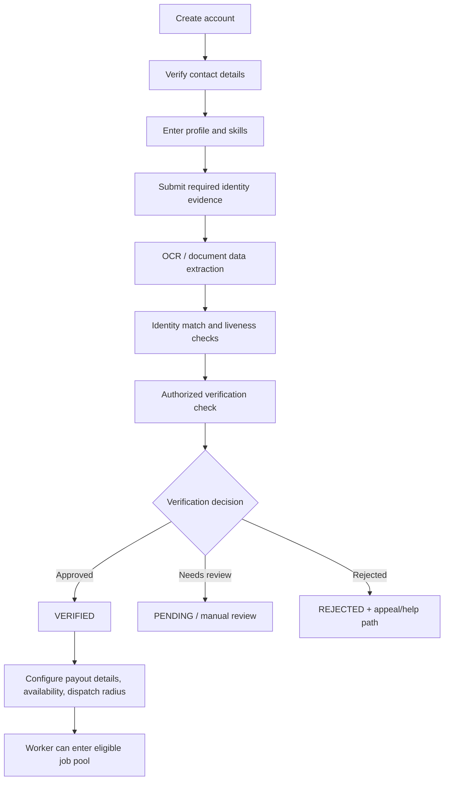
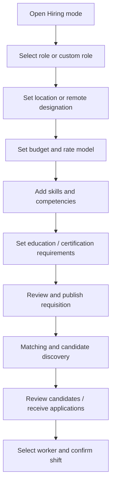

# Working Flows README

This document describes the product journeys and the backend state transitions that should support them. The original specification defines the main stages but does not define every status, timeout, cancellation, or dispute rule. Items labelled **Recommended state** are implementation proposals that require product approval.

## 1. Roles and modes

- **Worker / Vacancy mode:** onboard, verify identity and right-to-work status, build a profile, discover work, apply or accept a dispatch, coordinate a shift, and view payment status.
- **Employer / Hiring mode:** create a requisition, set role/location/budget/skills/qualifications, review workers, coordinate work, inspect completion, and settle or dispute payment.
- **Platform moderator / billing administrator:** restricted operational roles under RBAC. The source specifies separate permissions for moderators and billing administrators.

## 2. Worker onboarding and verification

**Specified verification states:** `PENDING_CITIZENSHIP_VERIFICATION`, `VERIFIED`, and `REJECTED`. The profile also displays `VERIFIED`, `PENDING`, or `UNVERIFIED` status. Keep internal workflow state and user-facing labels mapped consistently.

**Specified technical candidates:** Tesseract.js/Tesseract OCR, Python `face_recognition`/dlib or DeepFace with FaceNet/ArcFace, OpenCV/deep-learning liveness checks, and government or identity-verification APIs. These are candidate tools, not proof of legal authorization or production readiness. Confirm accuracy, bias, consent, lawful basis, vendor terms, and whether government APIs are actually available.

**Required rule:** unverified worker profiles are blocked from viewing shift assignments. Define carefully whether workers may still view public app information or complete their own profile while pending.

## 3. Worker profile and portfolio

The profile supports:

- First name, surname, and verified contact credentials.
- Verification status and geographic base.
- PDF/DOCX CV or resume.
- Short front-facing video pitch or skill demonstration.
- Minimum hourly rate, expected shift earnings, fixed/project pricing, and negotiable/non-negotiable rate preference.
- Skills, experience, and relevant work history.

Keep private identity evidence out of public profile APIs. A profile verification badge should reveal status, not identity-document images or full identification numbers.

## 4. Employer job-posting workflow

The source specifies pre-populated tracks such as Teacher, Mechanic, Engineer, Coder, and UI/UX, with custom roles such as Cleaner, Warehouse Associate, or Event Staff. It also supports on-site addresses, dispatch radiuses, geofenced checkpoints, remote work, hourly rates, project budgets, and milestone budgets.

**Decision required:** confirm whether every job is application-led, direct dispatch, invitation-only, or supports more than one mode. The source refers to both applications and dispatched workers but does not fully define the selection state machine.

## 5. Discovery and geospatial matching

- Match published shifts/jobs using required skills, proximity, availability, and worker acceptance/reliability information.
- Use PostGIS/spatial indexing and geohashes to find nearby opportunities and estimate travel distance/time.
- Worker view: map pins, distance, estimated commute, pay rate, and a brief job sheet.
- Employer view: authorized visibility of dispatched worker status, route/arrival estimate, and shift progress.
- Request location permissions only when a location-dependent feature is used. Offer manual location entry if permission is declined.
- Prefer coarse location for discovery. Reveal precise location only when a legitimate workflow requires it and the user has been informed.

Do not implement continuous worker tracking outside an active shift. The addendum explicitly requires shift-scoped tracking with notice and controls.

## 6. Dispatch and shift preparation

The source defines two reminder points:

| Time before shift | Action |
|---|---|
| 60 minutes | FCM push and fallback SMS to confirmed workers; ask them to tap **On My Way** |
| 30 minutes | Send final preparation details, site access instructions, contact details, and refreshed routing; alert the employer if commute has not been confirmed |

Use scheduled jobs and idempotent notification records so retries do not produce uncontrolled duplicate messages. A notification should be treated as a prompt, not proof that a worker has read or acted on it.

Recommended shift statuses (confirm before implementation): `DRAFT`, `PUBLISHED`, `OFFERED`, `ACCEPTED`, `CONFIRMED`, `ON_THE_WAY`, `IN_PROGRESS`, `COMPLETION_SUBMITTED`, `UNDER_REVIEW`, `COMPLETED`, `CANCELLED`, `DISPUTED`, `NO_SHOW`.

## 7. Shift attendance and completion

The source says the worker marks the assignment complete and that arrival/exit timestamps are verified. It also describes employer visibility of dispatched workers en route and geofenced checkpoints.

Recommended evidence model:

1. Record the shift's agreed start/end times and site geofence policy.
2. When permission is available and the shift is active, record only the location events necessary for the agreed attendance workflow.
3. Record worker arrival and completion submission with timestamps.
4. Allow employer review and a documented correction/dispute path.
5. Preserve an audit trail for edits and administrative overrides.

A geofence should be treated as supporting evidence, not unquestionable proof of work. Handle GPS inaccuracy, device offline periods, permission changes, and legitimate exceptions.

## 8. Payment reminder and resolution

The source specifies:

1. At shift wrap-up, create an invoice showing verified hours and the total payable amount.
2. Send an immediate invoice notification to the employer.
3. If review or settlement is pending, send a friendly reminder after 24 hours.
4. At 48 hours, send an escalation notice about imminent auto-escalation or administrative hold.
5. Show worker-facing states: `Awaiting Approval`, `Reminder Sent to Employer`, and `Processing Settlement`.
6. After the 48-hour window, provide an in-app action for the worker to flag unpaid work.

The wider specification also says funds may be held and released after mutual sign-off, geofenced exit verification, or the lapse of a 48-hour dispute inspection window. These statements do not completely define precedence or the exact legal/provider mechanism. **Do not code an automatic release rule until product, finance, payment-provider, and legal owners approve one canonical state machine.**

Recommended payment states to refine: `FUNDING_REQUIRED`, `FUNDED`, `AWAITING_COMPLETION`, `INVOICE_ISSUED`, `AWAITING_EMPLOYER_REVIEW`, `REMINDER_SENT`, `ESCALATED`, `DISPUTED`, `SETTLEMENT_PROCESSING`, `PAID`, `REFUNDED`, `FAILED`, `ON_HOLD`.

## 9. Ratings and reputation

The source specifies double-blind reviews: both sides submit 1–5 star ratings independently; scores reveal after both submit or after seven days. Reliability indexing considers punctuality, geofence presence, and cancellation frequency.

Protect against retaliation and manipulation. Avoid making opaque or unreviewable automated scores the sole basis for denying a person work. Give users understandable explanations and a path to challenge factual errors.

## 10. Cancellation, no-show, and dispute policy — decision required

The source does not fully define cancellation windows, late penalties, no-show evidence, dispute evidence requirements, appeals, or refund allocation. Write and approve those policies before enabling automatic penalties, ranking changes, or payment release.
